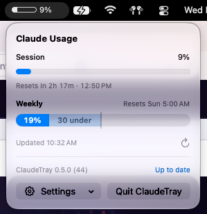

# ClaudeTray

A tiny native macOS menu bar app that shows your Claude usage limits at a glance.
The menu bar shows a progress bar for the current session (5-hour) window, or, for
accounts without a session limit, how your weekly usage is pacing. Click it for a panel
with both limits, when each resets, and whether you're on track to last the week.



## Install

Download the latest `ClaudeTray-X.Y.Z.dmg` from the
[Releases page](https://github.com/thegoldenmule/claude-tray/releases/latest), open it,
drag ClaudeTray onto the Applications folder in its window, and open ClaudeTray from
Applications. (The same app is also attached as a `.zip`.) The app is signed with Developer ID and notarized by Apple. Requires macOS 14 or
later and Claude Code logged in with a Pro or Max subscription.

## Requirements

To build from source:

- macOS 14 (Sonoma) or later
- Swift 6 toolchain (Xcode 16+ or Command Line Tools)
- [Claude Code](https://docs.claude.com/en/docs/claude-code) installed and logged in
  with a Claude Pro or Max subscription

## How it works

- Reads Claude Code's OAuth access token from the login Keychain item
  `Claude Code-credentials` by shelling out to `/usr/bin/security`. Claude Code
  creates that item with the same tool, so normally no Keychain prompt appears; if
  macOS does ask, choose "Always Allow".
- Calls the undocumented `GET https://api.anthropic.com/api/oauth/usage` endpoint
  and displays the `five_hour` (session) and `seven_day` (weekly) utilization, falling
  back to the response's `limits` array. Some accounts no longer have a session limit
  (`five_hour` is null); for those only the weekly limit is shown.
- Never refreshes or writes the token. If it has expired or the server rejects it
  (401/403), the app shows stale data until Claude Code refreshes it (just use
  Claude Code as normal). Meanwhile it re-checks the Keychain every minute and calls
  the API again only once the token has changed (or after 5 minutes). If Claude Code
  is logged out, the old numbers are cleared.
- If the Keychain can't be read (a denied prompt, a locked keychain, or no answer
  within 15 seconds), it retries after 1 minute, doubling up to 30 minutes.
- Polls every 5 minutes and right after the Mac wakes. Network errors retry after
  30 seconds, doubling up to 5 minutes. On HTTP 429 it backs off exponentially (up to
  30 minutes, or up to an hour if the server's `Retry-After` asks). Opening the panel
  or clicking refresh fetches immediately, at most once per minute.

## Weekly pace

The weekly limit is judged against an even spend of the budget over the window's
working time. By default that's weekdays only (by your Mac's calendar and time zone),
so after one of five weekdays you're expected to have used 20%. Tick "Count weekends in
weekly pace" in the panel to spread it over all seven days. The window is the server's
(e.g. Wednesday 4 AM to Wednesday 4 AM), not a calendar week.

- **Menu bar** (weekly mode): the bar shows usage, and a tick marks where you'd be at an
  even pace. The label is how many points over (`+30`) or under (`−12`) pace you are,
  `✓` when you're within the tolerance (your rate would end the week within ±10% of the
  budget, so the allowed gap is ±1 point when 10% is expected and ±9 when 90% is), or the plain percentage when it's too early to
  tell or the limit is reached. The bar turns orange when you're over pace, and red when
  the current rate runs out a full working day or more before the reset (or at 100%).
  On weekends with weekdays-only pacing the tick dims: pace is paused, though weekend
  usage still counts.
- **Panel**: the same bar and tick, how far off pace you are, and when you'd run out (or
  where you'd end the week) at this week's average rate.
- **Settings** (the panel's Settings menu): launch at login, count weekends, tolerance (±5 / ±10 / ±20% of the
  budget at reset, default ±10%), and what the menu bar shows. Auto shows the session bar when your
  account has a session limit and weekly pace when it doesn't, or when the weekly limit
  is about to run out first.

## Updates

The panel shows the running version and whether a newer release is out. ClaudeTray asks
GitHub's public `releases/latest` endpoint (unauthenticated) 10 seconds after launch, unless
the last answer is under an hour old, then every 12 hours and whenever the panel opens while
a check is due; a failed check retries after 30 minutes (or when GitHub's rate limit resets).
Requests reuse GitHub's ETag, so an unchanged release costs a body-less 304. The answer is
cached in the app's preferences (`updateCheckCache`). When a newer release exists, "Update
to X.Y.Z…" opens its release page; nothing is downloaded or installed automatically. Click
"Up to date" (or "Check for Updates") to check right away. `make dev` builds have no version
and never check. `CT_LIVE=1 swift test --filter liveUpdateCheck` runs a real check.

## Build and run

```sh
make run       # build, install to ~/Applications/ClaudeTray.app, quit any running copy, launch it
make install   # same, without launching
make app       # release build -> build/ClaudeTray.app, codesigned (staging only)
make dev       # swift run, no app bundle (quick iteration)
make test      # unit tests (pace math, response parsing, update check)
make clean
make icon            # regenerate Resources/AppIcon.icns from scripts/make-icon.swift
make dmg-background  # regenerate the release disk image's background in Resources/
```

`make run` installs to `~/Applications` and launches that copy; the bundle in
`build/` is moved there, never launched. `make app` signs with your first
"Apple Development" identity if you have one, otherwise ad-hoc. Override with
`make app SIGN_IDENTITY="..."`.

## Releasing

```sh
make release VERSION=1.2.3            # notarized universal app (dmg + zip) -> GitHub release
make release VERSION=1.2.3 DRY_RUN=1  # Developer ID-signed dmg and zip in dist/ only; nothing notarized or published
```

Releases are signed and notarized with an App Store Connect API key; there are no
certificates, passwords or notary profiles to set up. Put the key in a `.env` file at the
repo root (gitignored), or export the same variables:

```sh
ASC_KEY_ID=ABC123DEFG
ASC_ISSUER_ID=12345678-abcd-...
ASC_KEY_PATH=~/private_keys/AuthKey_ABC123DEFG.p8
```

The key needs the Admin role on the team, with access to cloud-managed Developer ID
certificates. Without a key the script falls back to the Apple account signed into Xcode
(Xcode › Settings › Accounts), which needs the Account Holder or Admin role.
`RELEASE_AUTH=xcode make release VERSION=…` forces the Xcode account even when a key is
configured: Apple refuses cloud-managed Developer ID signing to API keys (403
"You haven't been given access to cloud-managed distribution certificates"), even Admin
ones, so cloud signing currently needs the Xcode account. Building the disk image also needs
[uv](https://docs.astral.sh/uv/): the release runs a pinned
[dmgbuild](https://github.com/dmgbuild/dmgbuild) through `uvx`.

`make release` (see `scripts/release.sh`) checks that main is clean and in sync with
origin, sets `CFBundleShortVersionString` to the version and `CFBundleVersion` to the
commit count, commits and tags `vX.Y.Z` locally, and builds a universal (arm64 + x86_64)
app. It wraps the app in an `.xcarchive` and exports it with `xcodebuild -exportArchive
-allowProvisioningUpdates` (method `developer-id`, authenticated with the API key), which signs it with a cloud-managed
Developer ID certificate and uploads it to Apple's notary service, then waits for
`xcodebuild -exportNotarizedApp` to return the notarized, stapled app. It packages that
as `dist/ClaudeTray-X.Y.Z.dmg` (the app beside an Applications link, laid out by
`scripts/dmg-settings.py`) and `dist/ClaudeTray-X.Y.Z.zip`, checks the app in each passes
Gatekeeper as a quarantined download, and only then pushes the commit and tag and creates
the GitHub release with both files and their SHA-256s. The disk image itself is unsigned
(the cloud-managed certificate can't sign one locally); it still opens without a prompt,
and the app inside carries its own notarization ticket. If anything fails before the push, it removes the local commit and tag.
Override the team with `TEAM_ID=...`.

## Launch at login

Turn on Settings › "Launch at Login" in the panel once and it stays correct across
rebuilds. The checkmark shows your choice; a caption in the panel explains when the
system disagrees (a link to System Settings › Login Items if macOS needs approval, or the
registration error). While the choice is on, every launch re-registers the login
item (via `SMAppService`) from the running copy, so reinstalling, `make clean`, or
moving the app doesn't silently break it. If you turn ClaudeTray off in System
Settings › Login Items, the app respects that and doesn't re-register. The item
is disabled under `make dev`, since a bare executable can't be a login item.

## Caveats

- The usage endpoint is undocumented and may change or disappear without notice.
- Requests count against the same account rate limits Claude Code uses, which is
  why polling is deliberately infrequent.
- Not affiliated with or endorsed by Anthropic.

## License

MIT. See [LICENSE](LICENSE).
