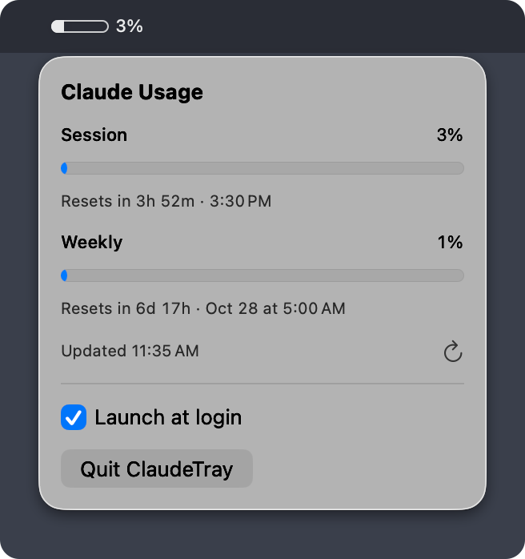

# ClaudeTray

A tiny native macOS menu bar app that shows your Claude usage limits at a glance.
The menu bar shows a progress bar for the current session (5-hour) window; click it
for a panel with both the session and weekly limits and when each resets.



## Install

Download the latest `.dmg` from the
[Releases page](https://github.com/thegoldenmule/claude-tray/releases/latest), open it,
drag ClaudeTray to Applications, and open it from there. Requires macOS 14 or later and
Claude Code logged in with a Pro or Max subscription.

## Requirements

To build from source:

- macOS 14 (Sonoma) or later
- Swift 6 toolchain (Xcode 16+ or Command Line Tools)
- [Claude Code](https://docs.claude.com/en/docs/claude-code) installed and logged in
  with a Claude Pro or Max subscription

## How it works

- Reads Claude Code's OAuth access token from the login Keychain item
  `Claude Code-credentials` by shelling out to `/usr/bin/security`. Claude Code
  creates that item with the same tool, so normally no Keychain prompt appears; if
  macOS does ask, choose "Always Allow".
- Calls the undocumented `GET https://api.anthropic.com/api/oauth/usage` endpoint
  and displays the `five_hour` (session) and `seven_day` (weekly) utilization.
- Never refreshes or writes the token. If it has expired or the server rejects it
  (401/403), the app shows stale data until Claude Code refreshes it (just use
  Claude Code as normal). Meanwhile it re-checks the Keychain every minute and calls
  the API again only once the token has changed (or after 5 minutes). If Claude Code
  is logged out, the old numbers are cleared.
- If the Keychain can't be read (a denied prompt, a locked keychain, or no answer
  within 15 seconds), it retries after 1 minute, doubling up to 30 minutes.
- Polls every 5 minutes and right after the Mac wakes. Network errors retry after
  30 seconds, doubling up to 5 minutes. On HTTP 429 it backs off exponentially (up to
  30 minutes, or up to an hour if the server's `Retry-After` asks). Opening the panel
  or clicking refresh fetches immediately, at most once per minute.

## Build and run

```sh
make run       # build, install to ~/Applications/ClaudeTray.app, quit any running copy, launch it
make install   # same, without launching
make app       # release build -> build/ClaudeTray.app, codesigned (staging only)
make dev       # swift run, no app bundle (quick iteration)
make clean
```

`make run` installs to `~/Applications` and launches that copy; the bundle in
`build/` is moved there, never launched. `make app` signs with your first
"Apple Development" identity if you have one, otherwise ad-hoc. Override with
`make app SIGN_IDENTITY="..."`.

## Releasing

```sh
make release VERSION=1.2.3            # notarized universal DMG -> GitHub release
make release VERSION=1.2.3 DRY_RUN=1  # signed DMG in dist/ only; nothing committed or published
```

`make release` (see `scripts/release.sh`) checks that main is clean and in sync with
origin, sets `CFBundleShortVersionString` to the version and `CFBundleVersion` to the
commit count, commits and tags `vX.Y.Z` locally, builds a universal (arm64 + x86_64)
app signed with your Developer ID, packages and signs `dist/ClaudeTray-X.Y.Z.dmg`,
notarizes and staples it, and only then pushes the commit and tag and creates the
GitHub release with the DMG and its SHA-256. If anything fails before the push, it
removes the local commit and tag. Override the identity with `DEVELOPER_ID="..."` and
the notary profile with `NOTARY_PROFILE=...`.

One-time setup:

1. Create a Developer ID Application certificate (requires the Account Holder role):
   Xcode › Settings › Accounts › select the team › Manage Certificates › + ›
   "Developer ID Application".
2. Create an app-specific password at <https://account.apple.com> › Sign-In and
   Security › App-Specific Passwords.
3. Store notarization credentials (prompts for the app-specific password):

   ```sh
   xcrun notarytool store-credentials claude-tray-notary \
       --apple-id you@example.com --team-id TEAM_ID
   ```

   `TEAM_ID` is the ID in parentheses at the end of your identity name, e.g.
   `QKMK66X2FU` in "Developer ID Application: Your Name (QKMK66X2FU)".

## Launch at login

Tick "Launch at login" in the panel once and it stays correct across rebuilds.
The checkbox shows your choice; a caption under it explains when the system
disagrees (a link to System Settings › Login Items if macOS needs approval, or the
registration error). While the choice is on, every launch re-registers the login
item (via `SMAppService`) from the running copy, so reinstalling, `make clean`, or
moving the app doesn't silently break it. If you turn ClaudeTray off in System
Settings › Login Items, the app respects that and doesn't re-register. The toggle
is disabled under `make dev`, since a bare executable can't be a login item.

## Caveats

- The usage endpoint is undocumented and may change or disappear without notice.
- Requests count against the same account rate limits Claude Code uses, which is
  why polling is deliberately infrequent.
- Not affiliated with or endorsed by Anthropic.

## License

MIT. See [LICENSE](LICENSE).
